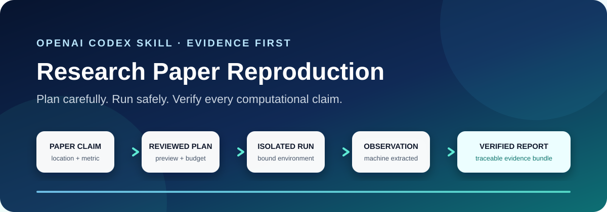

# 论文复现与实验验证：Codex Skill

<p align="center">
  
</p>

<p align="center">
  <strong>先规划，再执行；每一个计算 claim 都有证据可查。</strong>
</p>

<p align="center">
  面向论文复现、实验验证和计算可复现性的证据优先 Codex Skill。
</p>

<p align="center">
  <a href="README.md">English</a> · <a href="README_ZH.md">简体中文</a>
</p>

<p align="center">
  <a href="https://github.com/FullFighting/reproduce-research-paper/actions/workflows/validate.yml"></a>
  <a href="https://github.com/FullFighting/reproduce-research-paper/releases/latest"></a>
  <a href="https://www.python.org/"></a>
  <a href="benchmarks/benchmark-report.md"></a>
  <a href="LICENSE"></a>
</p>

> [!IMPORTANT]
> 本项目复现的是**明确声明的计算 claim**，不是给整篇论文判定“科学真伪”。命令成功或手工抄录指标都不足以得到正向结果；必须有运行绑定的机器观测、有效的仓库与策略检查，以及重新计算的比较结果。

## 从论文到可审计证据

| 规划 | 执行 | 验证 | 交付 |
|---|---|---|---|
| 通读论文，把准确 claim 映射到官方代码、数据和命令。 | 先预览预算和能力边界，得到明确批准后才执行。 | 从运行生成的工件中提取指标，重新计算类型化比较。 | 交付包含日志、哈希、provenance 和 claim-scoped 报告的可追溯证据包。 |

**适用场景：** 论文复现、科研实验复现、paper-to-code、实验结果验证、失败诊断和计算可复现性检查。

## 60 秒开始使用

只需 Python 3.10+ 和标准库即可安装：

```bash
git clone https://github.com/FullFighting/reproduce-research-paper.git
cd reproduce-research-paper
python scripts/install_skill.py --scope user
```

然后向 Codex 提供论文 PDF、URL、DOI 或标题：

```text
使用 $reproduce-research-paper 通读这篇论文，识别可执行 claim，
盘点官方代码和数据，并先生成只预览、不执行的论文复现计划。
未经我确认，不要下载数据或运行实验。
```

[查看离线演示](README.md#offline-demo) · [检查 15 个公开 claim](benchmarks/benchmark-report.md) · [阅读证据策略](skills/reproduce-research-paper/references/evidence-policy.md)

## 为什么它不只是“把代码跑起来”

| 常见捷径 | 证据优先做法 |
|---|---|
| “脚本正常退出了。” | 只接受声明的机器提取器从运行生成工件中读取的结果。 |
| “README 说这就是正确环境。” | 绑定完整代码树、Git 状态、数据、权重、配置和环境。 |
| “这个数字看起来差不多。” | 使用预先声明的容差或统计策略比较类型化数值。 |
| “手工把图表中的值记下来即可。” | 手工表格和图片始终保留为 `MANUAL_REVIEW_REQUIRED`。 |
| “指标匹配说明论文正确。” | 只报告限定范围的计算 claim，并保留因果解释与一般化边界。 |

> [!NOTE]
> V1.4 增加仓库级 lint 门禁、Python 3.10–3.13 CI 矩阵，以及一份数据由 CI 强制保鲜的 [Codex Open Source Fund 申请材料](docs/codex-fund-application.md)。V1.3 增加了仅供维护者本地运行的 OpenAI API 评测 CLI、5 个真实来源的拒绝/阻塞/修订案例、独立评审与裁决记录、恶意研究材料威胁模型、Docker 加固和安全安装器。目前尚未发布付费 API 实测结果。

> 本结果只验证记录环境和协议下声明的计算 claim，不验证整篇论文的真实性、因果解释或一般化能力。

## 为什么需要 Codex

科研复现同时需要语义推理和确定性验证。Codex 负责通读论文、定位可执行 claim、映射官方代码/数据/命令、生成可评审的 preview-only 计划、诊断失败和提出回归测试；确定性 runtime 负责隔离执行、机器提取、provenance 校验、重新比较和生成 claim-scoped 报告。Codex 不负责给论文判定“科学真伪”。

[Codex 规划评估试点](docs/codex-evaluation/README.md)公开了 3 个论文/仓库案例的初始提示、草案计划、评审记录、修订计划、证据链接和 telemetry 限制。它来自本次 Codex desktop 工作流，不冒充经过独立人工评审的正式基准。

## 成熟度

| 组件 | 状态 |
|---|---|
| 确定性证据 runtime | Stable v1.4 |
| 公开 claim-level benchmark | 15 个已验证案例 |
| Codex 规划试点 | 3 个案例；自评审加确定性反馈 |
| 维护者本地 API 评测 | CLI 已可运行；5 个真实来源负例；尚未发布付费实测结果 |
| 独立人工评测 | 协议和 reviewer call 已发布；尚未完成 |
| 广泛外部采用 | 早期；尚无已核实外部采用者 |
| 科学运行签名 | 规划中；发布归档已有 GitHub build attestation |

15 个确定性案例不是 Codex 效果评测；3 个 pilot 也不冒充独立人工评审。

## 已完成的公开验证

[公开基准报告](benchmarks/benchmark-report.md)包含 15 个公开、关联论文、低成本、claim-level 的可执行案例，来源包括 Nature、Nature Methods、JMLR、KDD、NeurIPS、ICML、Journal of Financial Economics 和 Mathematical Programming Computation 等。

<!-- benchmark-facts:start -->
- 15 个公开、关联论文、claim-level 的可执行案例；
- 15/15 个 claim 在预声明容差内复现；
- 15/15 个 evidence bundle 通过重新哈希、重新比较和重新渲染报告；
- 确定性 runtime 使用 0 个 API token，估算外部 API 成本 $0；
<!-- benchmark-facts:end -->
- 每个 benchmark plan 均声明 GPU 预算为 0；
- 每个案例公开论文与代码链接、计划、环境锁、数据及许可说明、原始日志、观测、比较、最终报告、provenance 和偏差限制。

这些是边界清楚的 claim-level 可执行检查，不会把低成本烟雾测试冒充为原论文全部大型实验的完整复现。

## 主要安全边界

- schema v2 支持 scalar、array、带标签 table、ranking、categorical、string、artifact hash 和 distribution；
- 单位采用 `symbol + scale + semantic_type`，可表达 BLEU、F1、能耗、FLOPs、吞吐、货币、基点和自定义指标；
- 全量代码树、Git commit、dirty diff、submodule、数据、权重、配置和环境锁分别哈希；
- 执行前后检查原仓库与运行 workspace，未声明写入会使证据失效；
- 支持 copy、独立 Git worktree、只读源码挂载的 Docker container 三种模式；container 强制 digest-only 镜像、`--pull never`、`--cap-drop ALL`、禁止提权、受限 seccomp 和非 root 数字用户；
- 网络、CPU、内存、磁盘、GPU、输出数量和写目录必须声明；
- 密钥默认只能通过环境变量 `secret_bindings` 注入；argv secret 默认拒绝，只有显式高风险兼容模式才允许并记录偏差；
- 最终报告从原始工件重新计算，不信任 comparison 中已有的 verdict；
- 修改任一已登记工件都会导致 bundle 校验失败。

## 使用

```text
使用 $reproduce-research-paper 阅读这篇论文的全部内容，识别可执行 claim，
盘点官方代码仓库并先生成只预览、不执行的复现计划。
未经我确认，不要下载数据或运行实验。
```

一键安装、更新、检查和卸载：

```bash
python scripts/install_skill.py --scope user
python scripts/install_skill.py --scope repository --target /path/to/repository
python scripts/install_skill.py --action check --scope user
python scripts/install_skill.py --action update --scope user
python scripts/install_skill.py --action uninstall --scope user
```

Linux/macOS 验证与预览：

```bash
python3 skills/reproduce-research-paper/scripts/validate_reproduction_plan.py \
  --plan skills/reproduce-research-paper/assets/examples/reproduction-plan.json

python3 skills/reproduce-research-paper/scripts/run_reproduction.py \
  --plan skills/reproduce-research-paper/assets/examples/reproduction-plan.json \
  --output reproduction-output
```

Windows PowerShell 验证、预览、执行和校验：

```powershell
python skills/reproduce-research-paper/scripts/validate_reproduction_plan.py `
  --plan skills/reproduce-research-paper/assets/examples/reproduction-plan.json

python skills/reproduce-research-paper/scripts/run_reproduction.py `
  --plan skills/reproduce-research-paper/assets/examples/reproduction-plan.json `
  --output reproduction-output

python skills/reproduce-research-paper/scripts/run_reproduction.py `
  --plan skills/reproduce-research-paper/assets/examples/reproduction-plan.json `
  --output reproduction-output `
  --execute

python skills/reproduce-research-paper/scripts/build_report.py `
  --bundle reproduction-output
```

## 维护者本地 API 评测

`evaluations/run_codex_evaluation.py` 只在维护者本机运行。默认只预览；只有显式提供模型、成本上限、输出目录和 `--send`，并从当前进程环境读取 `OPENAI_API_KEY` 后，才会调用固定的官方 Responses API。Key、请求头、Organization 凭据和环境变量不会写入日志或 evidence bundle。

```bash
python evaluations/run_codex_evaluation.py --validate-cases

python evaluations/run_codex_evaluation.py \
  --case mimic-iv-redistribution-prohibited \
  --model gpt-5.6-terra
```

详见[评测说明](evaluations/README.md)、[评测协议](evaluations/protocol.md)、[恶意研究材料威胁模型](docs/threat-model.md)和[独立评审招募](docs/independent-review-call.md)。完整设计、开发命令和 V1.3 证据见[英文 README](README.md)。

## 致谢

本项目由 [FullFighting](https://github.com/FullFighting) 维护，开发过程由两个 AI 编程助手协助：

- [Codex](https://github.com/codex)（OpenAI）——承担了 skill 设计背后的桌面规划工作流、三案例规划评估试点，以及多份仓库文档的起草。
- [Claude](https://github.com/claude)（Anthropic）——协助仓库维护与工作流自动化。
